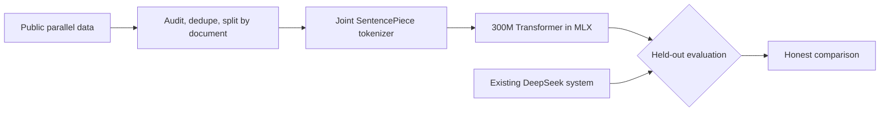

# ThaiPoAI

**Can a Thai ↔ English translator trained from random weights on a laptop hold its own against a hosted LLM pipeline?**

[ThaiPo](https://thaipo.ai) translates English-Thai chat in production using DeepSeek, a glossary and automatic corrections. This project trains a roughly 300-million-parameter model from scratch in [MLX](https://github.com/ml-explore/mlx) on an M4 Max MacBook Pro, then measures it against that system, one direction at a time. We don't assume it wins. A clear measurement of the gap is the result.

> **Status:** no model has been trained yet. The evaluation tools and the serving platform work. [`SPEC.md`](SPEC.md) is the plan.

## The plan



| # | Step | State |
|---|---|---|
| 1 | Inspect the repo, replace the plan | Done |
| 2 | Build the evaluation sets first | Corpus held-out splits and suites ready. FLORES+ pending |
| 3 | Prove training works: overfit, all weights move, exact resume | Built, awaiting review |
| 4 | Benchmark the laptop over several hundred real steps | Measured, awaiting review |
| 5 | Train on public data, evaluating checkpoints as it goes | Human-translated mix trained. Distilled corpus being built ([plan](docs/distillation-plan.md)) |
| 6 | Adapt to application data | Removed: public data only ([SPEC 4.5](SPEC.md)) |
| 7 | Compare with the production system, per direction | |

## What's here

| Path | What it is |
|---|---|
| [`SPEC.md`](SPEC.md) | The experiment: model, data, evaluation, sequence |
| [`train/`](train) | Source registry, corpus builder and release packager, tokenizer, Transformer and MLX trainer |
| [`docs/distillation-plan.md`](docs/distillation-plan.md) | Plan for the distilled corpus: sources, audit, cleaning rules, scores to beat |
| [`evaluation/`](evaluation) | Paired comparison, meaning judge, suite drafting, baseline run |
| [`suites/`](suites) | Synthetic test cases with intended meanings |
| [`data/`](data) | Synthetic chat pairs and the MASSIVE rows that passed a meaning check |
| [`cmd/gateway`](cmd/gateway) | Translation API with guards. Never logs text |
| [`cmd/rollout-controller`](cmd/rollout-controller) | Kubernetes controller for eval-gated model rollouts |
| [`cmd/extract-audit`](cmd/extract-audit) | Release gate that tests a model for memorised personal details |
| [`cmd/suite`](cmd/suite), [`cmd/fake-model`](cmd/fake-model) | Suite runner and a deterministic model for tests |
| [`deploy/kind`](deploy/kind) | Local cluster and the fault matrix that CI runs |

## How model rollouts are gated

A candidate moves through `Verifying → Golden → Shadow → Canary → Promoted`. Quality gates count only the cases where the two models disagree, using exact tests. An infrastructure failure ends in `Inconclusive` and never blames the model. The design is in [`docs/rollout-states.md`](docs/rollout-states.md), and CI kills components mid-canary on a real kind cluster to prove it. So far the stack has run against a fake model and the earlier pretrained models.

## Why from scratch

We first tried downloading open models and fine-tuning them. The best candidate, an untuned Gemma with retrieved examples, came close but did not clear the bar, and both LoRA adapters made the model worse. [`docs/pretrained-experiments.md`](docs/pretrained-experiments.md) records every experiment and its numbers.

## Running it

Go 1.25 and Python 3.12 with [uv](https://docs.astral.sh/uv/). The cluster steps need Docker, kind and kubectl.

```bash
go test ./...
```

```bash
uv run pytest
```

```bash
deploy/kind/up.sh && deploy/kind/fault-matrix.sh
```

The training corpus and tokenizer are published as a versioned release. Download one and check it:

```bash
curl -LO https://github.com/sacreman/thaipoai/releases/download/corpus-v1/corpus.tgz
```

```bash
curl -LO https://github.com/sacreman/thaipoai/releases/download/corpus-v1/corpus.tgz.sha256
```

```bash
shasum -a 256 -c corpus.tgz.sha256 && tar -xzf corpus.tgz
```

Then train:

```bash
uv run python -m train.train --config full --sources scb,mtop,massive --out runs/combined-full
```

## Data and licences

Code is [Apache-2.0](LICENSE). The published corpus is CC BY-SA 4.0, with its sources credited in `NOTICE.md`. Dataset choices, licences and open questions are in [`docs/data-sources.md`](docs/data-sources.md). Everything in this repository is public or synthetic. The training data has CC BY-SA sources, so the weights will be CC BY-SA. No private chat text is stored here.

Built with AI coding agents, designed and reviewed by Steven Acreman.
