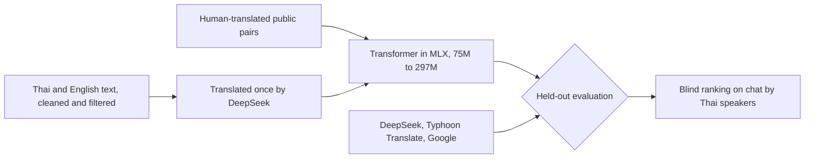

# ThaiPoAI

**Can a Thai ↔ English translator trained from random weights on a laptop hold its own against a hosted LLM pipeline?**

[ThaiPo](https://thaipo.ai) translates English-Thai chat in production using DeepSeek, a glossary and automatic corrections. This project trains a model of under 300 million parameters from scratch in [MLX](https://github.com/ml-explore/mlx) on an M4 Max MacBook Pro, then measures it against that system, one direction at a time. We don't assume it wins. A clear measurement of the gap is the result.

The outcome aimed for is narrow: the best translator for informal one-to-one chat between Thai and English in a model under 300 million parameters, shown by Thai speakers preferring its output, blind, to DeepSeek's, Typhoon Translate's and Google's on chat messages none of them has seen. FLORES-200 is a secondary line: match or beat Typhoon Translate 1.5.

> **Status, 12 November 2026:** a 75M model has been trained on about 299,000 human-translated pairs. It is close to DeepSeek on text like its training data and far behind elsewhere. A much larger corpus is being collected for DeepSeek to translate; nothing has been translated yet. [`SPEC.md`](SPEC.md) is the plan.

## Where it stands

chrF with the project's own script, greedy decoding. FLORES-200 is the 1,012 devtest sentences.

| System | 2,000 validation rows | 900 unfamiliar pairs | FLORES-200, English to Thai | FLORES-200, Thai to English |
|---|---:|---:|---:|---:|
| DeepSeek Flash | 46.7 | 61.5 | 59.08 | 63.81 |
| Typhoon Translate 1.5 (4B) | | | 54.22 | 52.46 |
| This project, 75M, human-translated data | 44.7 | 36.2 | about 26 | about 30 |

The gap is coverage, so the next step is a distilled corpus: a billion clean words of text in one language, 600 to 700 million of them Thai, each row translated once by DeepSeek Flash. On 12 November about 900 million Thai words pass the local rules and about 684 million are counted clean. Nearly all of it is web text and news with no clear licence for the text itself, kept in a second licence tier that can be removed in one step. Conversational Thai is under 2% and is the known gap. The crawl collection and the filters that score it are not yet reproducible from this repository. [`docs/distillation-plan.md`](docs/distillation-plan.md) has the plan and the evidence.

## The plan



| # | Step | State |
|---|---|---|
| 1 | Inspect the repo, replace the plan | Done |
| 2 | Build the evaluation sets first | Corpus held-out splits and suites ready. FLORES-200 scored. Human-translated chat test set not started |
| 3 | Prove training works: overfit, all weights move, exact resume | Built, awaiting review |
| 4 | Benchmark the laptop over several hundred real steps | Measured, awaiting review |
| 5 | Train on public data, evaluating checkpoints as it goes | Human-translated mix trained. Source text for the distilled corpus being collected ([plan](docs/distillation-plan.md)) |
| 6 | Adapt to application data | Removed: public data only ([SPEC 4.5](SPEC.md)) |
| 7 | Compare with the production system, per direction, and rank blind on chat | |

## What's here

| Path | What it is |
|---|---|
| [`SPEC.md`](SPEC.md) | The experiment: model, data, evaluation, sequence |
| [`train/`](train) | Source registry, corpus builder and release packager, tokenizer, Transformer and MLX trainer, builder for the distillation source text, teacher client |
| [`docs/distillation-plan.md`](docs/distillation-plan.md) | Plan for the distilled corpus: target, sources, cleaning, order of work, what other work shows |
| [`docs/distillation-sources.md`](docs/distillation-sources.md) | Record of every source, licence, rule and sample score in the distillation source text |
| [`docs/steps/`](docs/steps) | Write-ups of the training gate, the laptop benchmark and the first training runs |
| [`evaluation/`](evaluation) | Paired comparison, meaning judge, suite drafting, baseline run |
| [`suites/`](suites) | Synthetic test cases with intended meanings |
| [`data/`](data) | Synthetic chat pairs and the MASSIVE rows that passed a meaning check |
| [`cmd/gateway`](cmd/gateway) | Translation API with guards. Never logs text |
| [`cmd/rollout-controller`](cmd/rollout-controller) | Kubernetes controller for eval-gated model rollouts |
| [`cmd/extract-audit`](cmd/extract-audit) | Release gate that tests a model for memorised personal details |
| [`cmd/suite`](cmd/suite), [`cmd/fake-model`](cmd/fake-model) | Suite runner and a deterministic model for tests |
| [`deploy/kind`](deploy/kind) | Local cluster and the fault matrix that CI runs |

## How model rollouts are gated

A candidate moves through `Verifying → Golden → Shadow → Canary → Promoted`. Quality gates count only the cases where the two models disagree, using exact tests. An infrastructure failure ends in `Inconclusive` and never blames the model. The design is in [`docs/rollout-states.md`](docs/rollout-states.md), and CI kills components mid-canary on a real kind cluster to prove it. So far the stack has run against a fake model and the earlier pretrained models.

## Why from scratch

We first tried downloading open models and fine-tuning them. The best candidate, an untuned Gemma with retrieved examples, came close but did not clear the bar, and both LoRA adapters made the model worse. [`docs/pretrained-experiments.md`](docs/pretrained-experiments.md) records every experiment and its numbers.

## Running it

Go 1.25 and Python 3.12 with [uv](https://docs.astral.sh/uv/). The cluster steps need Docker, kind and kubectl.

```bash
go test ./...
```

```bash
uv run pytest
```

```bash
deploy/kind/up.sh && deploy/kind/fault-matrix.sh
```

The human-translated corpus and its tokenizer are published as a versioned release. The distilled corpus is not published. Download the release and check it:

```bash
curl -LO https://github.com/sacreman/thaipoai/releases/download/corpus-v1/corpus.tgz
```

```bash
curl -LO https://github.com/sacreman/thaipoai/releases/download/corpus-v1/corpus.tgz.sha256
```

```bash
shasum -a 256 -c corpus.tgz.sha256 && tar -xzf corpus.tgz
```

Then train:

```bash
uv run python -m train.train --config full --sources scb,mtop,massive --out runs/combined-full
```

## Data and licences

Code is [Apache-2.0](LICENSE). The published corpus is CC BY-SA 4.0, with its sources credited in `NOTICE.md`. Dataset choices, licences and open questions are in [`docs/data-sources.md`](docs/data-sources.md). Everything in this repository is public or synthetic. The published corpus has CC BY-SA sources, so weights trained on it would be CC BY-SA. No weights are published yet. The distillation source text has two licence tiers, and whether the second stays is decided before that corpus or any weights trained on it are released ([SPEC 4.4 and 4.6](SPEC.md)). No private chat text is stored here.

Built with AI coding agents, designed and reviewed by Steven Acreman.
